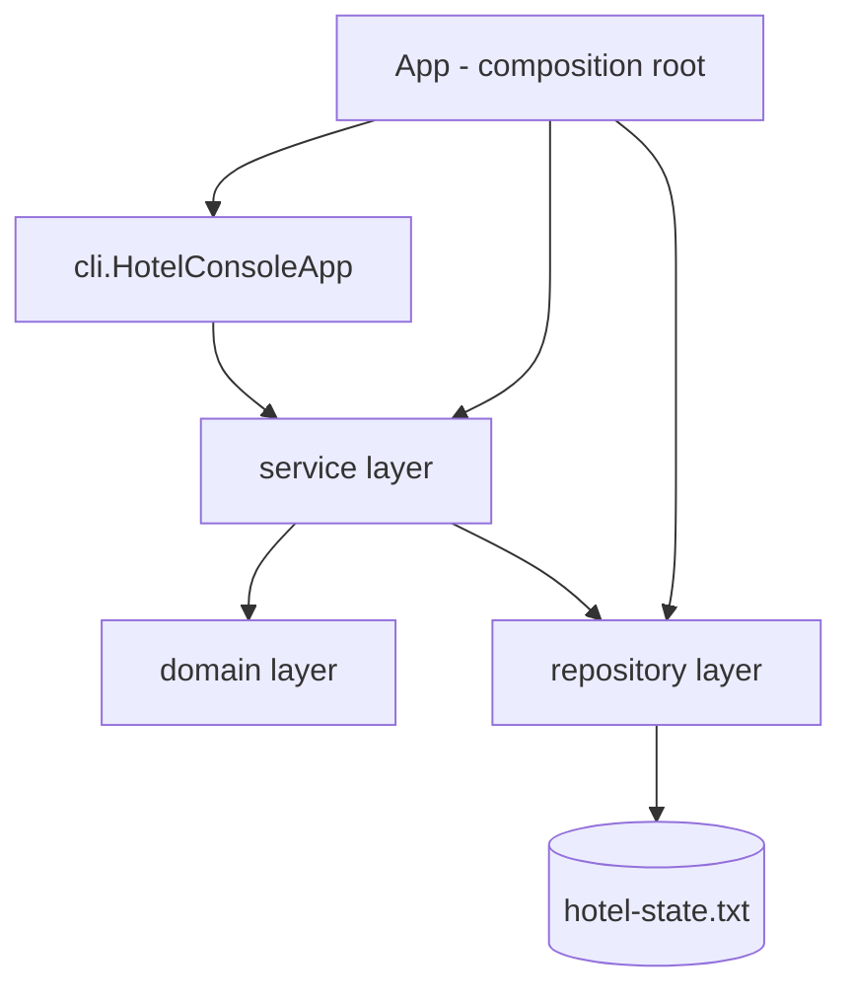
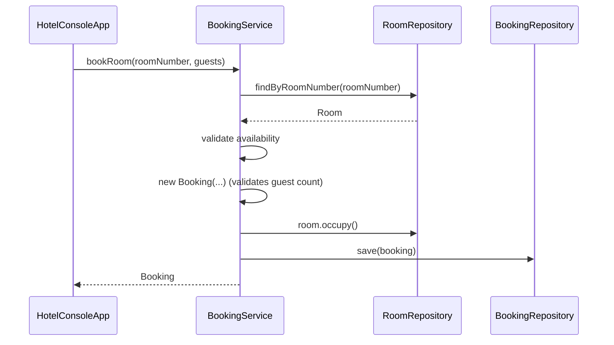
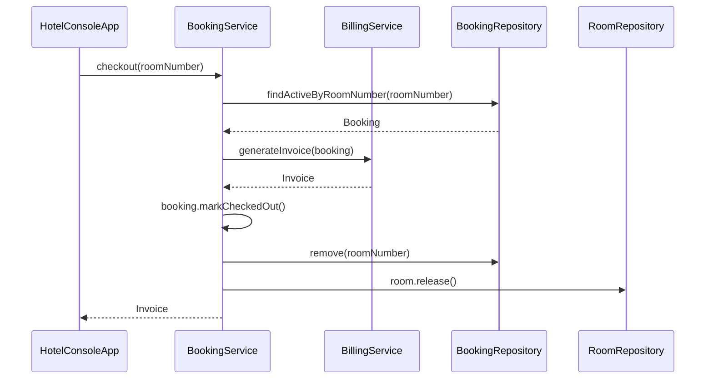

# Architecture

## Layers

- **`cli`** — all console I/O (`Scanner`, `System.out`). Owns menu flow and input parsing
  (`ConsoleIO`). Never touches a repository directly; every state change goes through a service.
- **`service`** — business logic and orchestration. `BillingService` is pure (no I/O), which is
  what makes it trivial to unit test. `BookingService` and `FoodOrderService` coordinate between
  repositories and domain objects, enforcing invariants (no double-booking, no orphaned food
  orders).
- **`domain`** — the model: `Room`, `RoomType`, `Booking`, `Guest`, `FoodOrder`, `Invoice`, and
  value objects `Money` and `ContactNumber`. Domain objects validate their own invariants in
  their constructors (e.g. a `Booking` cannot be built with the wrong number of guests for its
  room type), so invalid domain objects cannot exist.
- **`repository`** — data access. `RoomRepository`/`BookingRepository` are the in-memory source
  of truth while the app runs. `HotelStateRepository` is the one persistence boundary, backed by
  `FileHotelStateRepository` (see [design-decisions.md](design-decisions.md) for why it's a
  custom plain-text format rather than Java serialization).
- **`exception`** — a small hierarchy rooted at `HotelDomainException`, one subtype per class of
  business-rule violation.
- **`validation`** — small stateless helpers shared by the service and CLI layers.
- **`config`** — `HotelConfig`, the only externally-configurable setting (the storage file path).
- **`App`** — the composition root. Wires repositories to services to the CLI, restores persisted
  state at startup, and saves it back on exit. Contains no business logic.

## Data flow: booking a room

A booking's guest-count validation happens in the `Booking` constructor **before** the room is
marked occupied, so a rejected booking (e.g. wrong guest count) never leaves the room in a
half-occupied state.

## Data flow: checkout

The invoice is computed **before** the booking is marked checked out and the room released, so a
failure while computing the bill cannot leave the room released with no invoice ever produced.

## Room numbering

Room numbers are a single flat range 1-60 covering four types, unchanged from the original
application so existing room numbers behave identically:

| Room type      | Numbers | Occupancy | Daily rate |
|-----------------|---------|-----------|-----------:|
| Luxury Double   | 1-10    | 2 guests  | ₹4,000     |
| Deluxe Double   | 11-30   | 2 guests  | ₹3,000     |
| Luxury Single   | 31-40   | 1 guest   | ₹2,200     |
| Deluxe Single   | 41-60   | 1 guest   | ₹1,200     |

`RoomType.forRoomNumber(int)` is the single source of truth for this mapping — nothing else in
the codebase hard-codes the number ranges.
